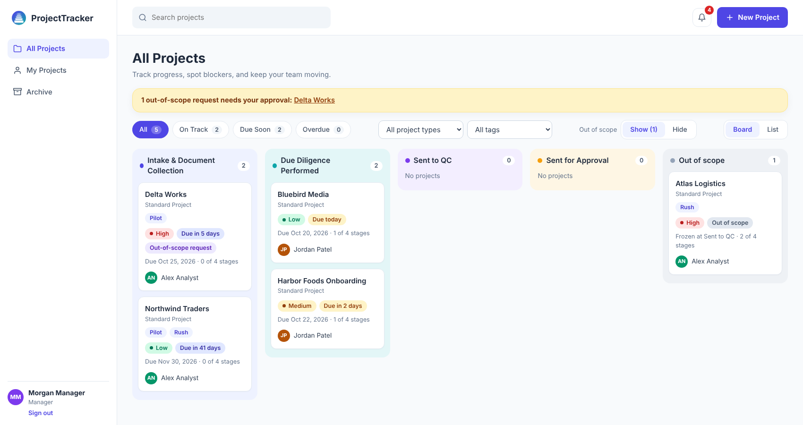
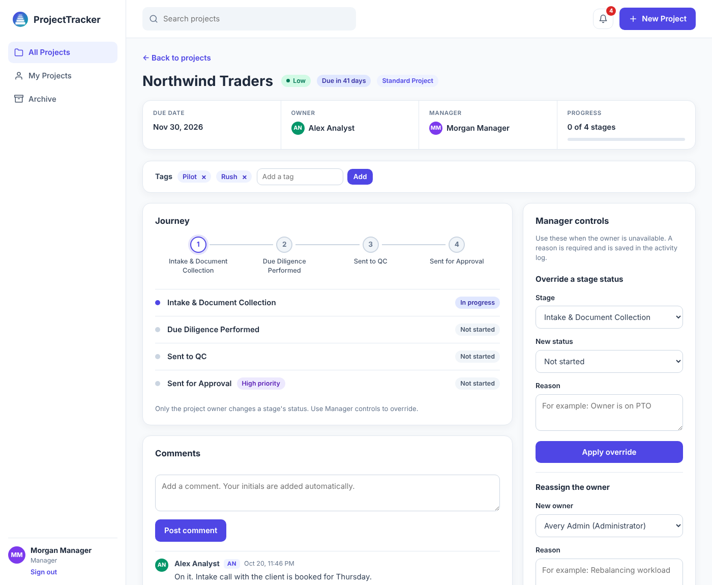
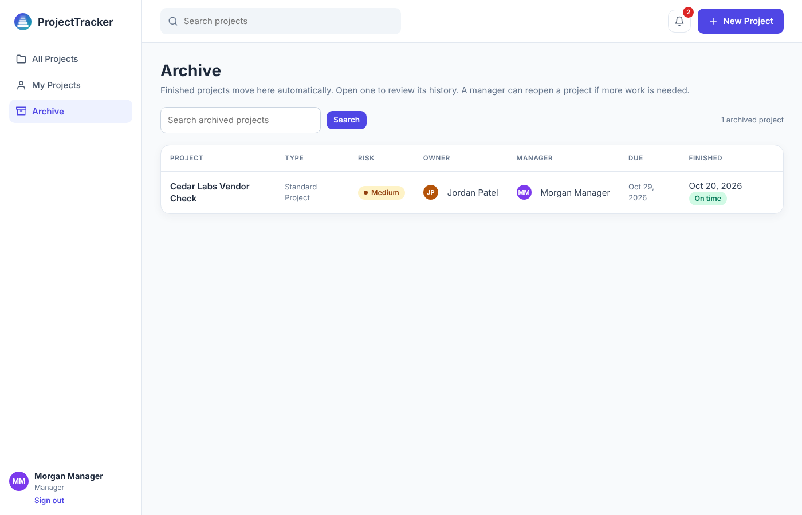
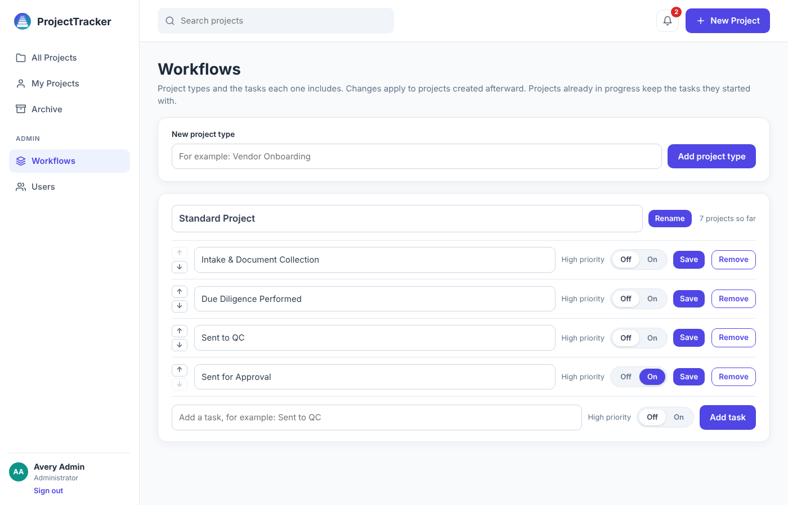
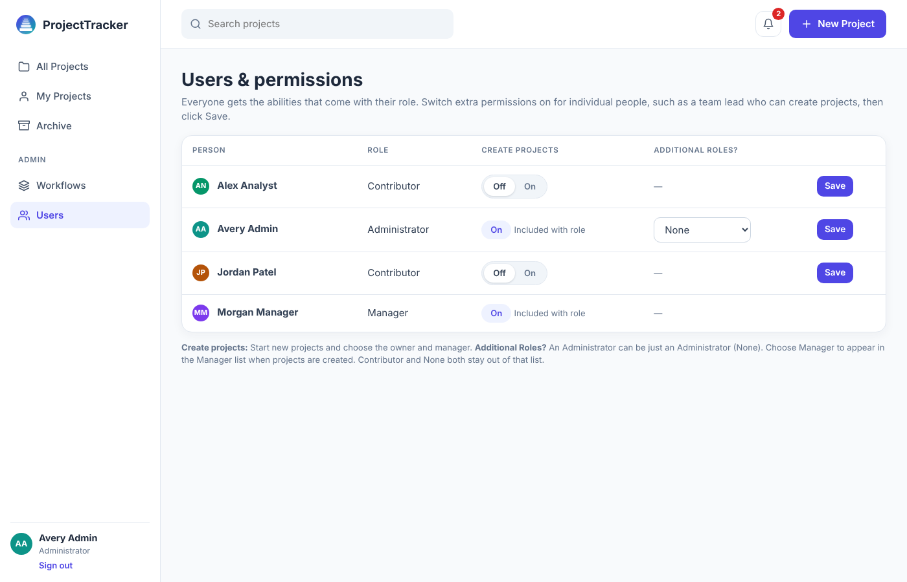
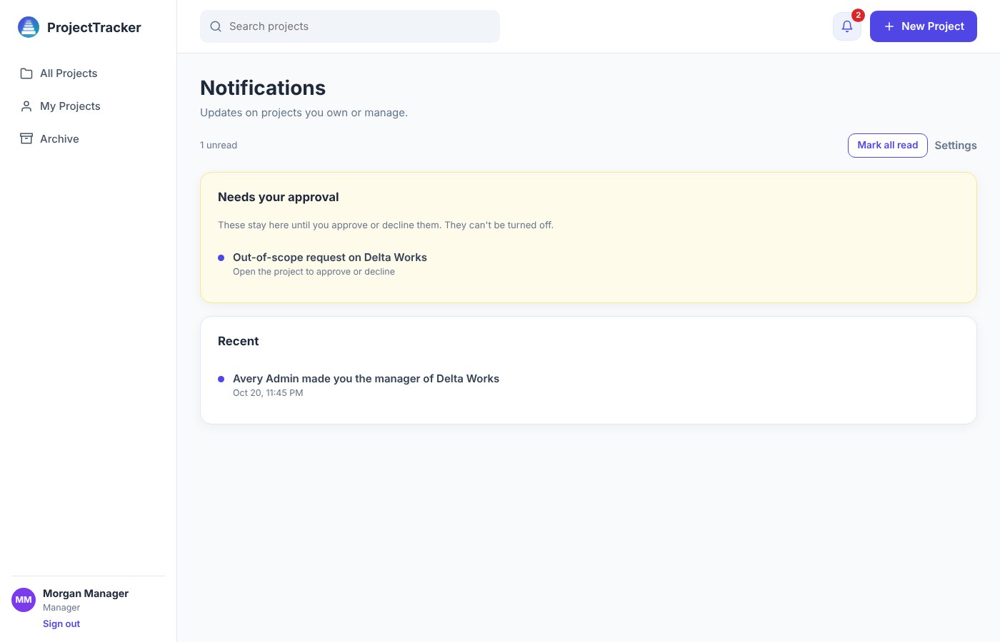

# ProjectTracker

A role-based project tracker built with Flask and SQLite. Teams move projects through a defined set of stages, managers can override and reassign work, and every change is recorded in an activity log.

I built it to practice full-stack Python while modeling a workflow I know from compliance work: tasks that must be completed in order, accountability for who changed what and why, and approval before something is closed out of scope.



## Features

**Roles and permissions**
- Three roles: Administrator, Manager, and Contributor (analyst).
- Managers and Administrators can create projects. Administrators can grant "Create projects" to individual Contributors with an Off/On toggle.
- Administrators can switch demo mode off to remove the demo sign-in details from the login page. The Users page warns about accounts that still use the demo password.
- Administrators add people (name, username, role, temporary password) and can reset a password. Everyone can change their own password from the sidebar.
- An Administrator can also hold a second role (Contributor or Manager). Only people acting as managers appear in the Manager list.

**Project types and workflows**
- Administrators define project types and their tasks: add, rename, remove, reorder, and flag a task as high priority.
- A new project gets its own frozen copy of its type's tasks. Later workflow changes never affect projects already in flight.

**Visibility**
- Everyone can see every project, but only a project's owner changes its stages. Managers and Administrators can see all projects too.
- A project's manager (or an Administrator) can mark a project **Restricted** and choose which people may see its details. Everyone else sees a locked "Restricted project" placeholder with no name, people, type, or tags.
- Owners, the project's manager, and Administrators always keep access.

**Working a project**
- Board and list views, status filters (On Track, Due Soon, Overdue), type and tag filters, and search.
- The project owner updates each stage (Not started, In progress, Complete).
- Comments and tags are limited to the project's owner, manager, and Administrators. Everyone else reads.
- Managers can override a stage status or reassign the owner. A written reason is required, and it is saved in the activity log.

**Out of scope**
- A Contributor requests that a project be marked out of scope. The project's manager approves or declines, with a reason required to decline.
- Managers and Administrators can mark a project out of scope directly, and return it to scope later.
- Out-of-scope projects freeze where they are. A Show/Hide toggle controls whether they appear on All Projects.

**Archive**
- When the last stage is completed, the project moves to the Archive automatically, with an On time or N days late label.
- Archived projects are read-only. A manager can reopen one by choosing a stage and giving a reason.

**Notifications, comments, and tags**
- In-app bell and inbox. Each person can turn five categories on or off: assignments, progress, out-of-scope decisions, archive events, and comments.
- Out-of-scope requests waiting for a manager's decision always appear and cannot be muted.
- Comments are stamped automatically with the author's initials and can be archived and restored.
- Free-form tags can be added by anyone who can see a project and are used to filter All Projects.

**Audit trail**
- Status changes, overrides, reassignments, scope decisions, archive and reopen events, and tag changes are all written to a read-only activity log with the person and reason.

## Screenshots

| Project page | Archive |
| --- | --- |
|  |  |

| Workflows (admin) | Users and permissions (admin) |
| --- | --- |
|  |  |



## Security notes

- Passwords are never stored. Only salted hashes are saved (Werkzeug), so they cannot be decrypted.
- The login cookie is signed, `HttpOnly`, and `SameSite=Lax`. Set `SECRET_KEY` to a long random value, and `COOKIE_SECURE=1` when running behind HTTPS.
- Every form carries a CSRF token tied to the session, and the server rejects any change without a valid one.
- Every permission rule is checked on the server, not just hidden in the interface.
- Project data in SQLite is not encrypted at rest.

## Tech stack

- Python 3 and Flask 3 (routes, Jinja templates)
- SQLite through the standard `sqlite3` module, with lightweight schema migrations in `db.py`
- Plain HTML and CSS, no JavaScript framework
- Werkzeug password hashing

## Run it locally

```bash
git clone https://github.com/jeremiahpowell123-arch/ProjectTracker
cd ProjectTracker

python3 -m venv .venv
source .venv/bin/activate        # Windows: .venv\Scripts\activate
pip install -r requirements.txt

python app.py
```

Open http://127.0.0.1:5001. Run the command from the project folder, because `tracker.db` is created in the folder you run from.

The first run creates `tracker.db` with three demo accounts and a default project type. To start over, stop the app and delete `tracker.db`.

In PyCharm, you can also right-click `app.py` and choose Run.

### Demo accounts

| Username | Password | Role |
| --- | --- | --- |
| `admin` | `demo1234` | Administrator |
| `manager` | `demo1234` | Manager |
| `analyst` | `demo1234` | Contributor |

The sign-in page lists these accounts while demo mode is on. An Administrator can turn demo mode off from the **Users** page, which hides the usernames and password from the sign-in page. It does not change the passwords, so reset them before sharing the app.

A good first tour: sign in as `admin`, open **Users** to grant permissions, open **Workflows** to edit a project type, then create a project and assign it to `analyst`.

## Run the tests

```bash
pip install -r requirements-dev.txt
pytest
```

The suite has about 120 tests covering roles and permissions, project workflows, stage changes and overrides, the Archive, out-of-scope approval, notifications, comments, tags, restricted projects, accounts and passwords, demo mode, and CSRF protection. Each test runs against a fresh temporary database, so it never touches `tracker.db`. The same tests run automatically on GitHub through `.github/workflows/tests.yml`.

## Project layout

```
app.py             Flask app: routes, permissions, notifications, helpers
db.py              Schema, migrations, and demo data
templates/         Jinja templates
static/            CSS and logo
tests/             pytest suite
```

## Known limitations

This is a learning and portfolio project, not production software.

- The Flask secret key falls back to a demo value unless a `SECRET_KEY` environment variable is set, and the app runs in debug mode. Both would need to change before real use.
- The demo accounts share a known password. New people are not forced to change their temporary password at first sign-in, and accounts cannot be deactivated.
- The app does not serve HTTPS itself. Traffic is only encrypted if it is deployed behind HTTPS.
- Notifications are in-app only. There is no email.
- SQLite and a single process are fine for a demo, but not for many users at once.

## Ideas for next steps

- Forced password change at first sign-in, and deactivating users
- Admin page to manage tags
- Email notifications
- Make logout a POST request, so it is covered by CSRF protection too
